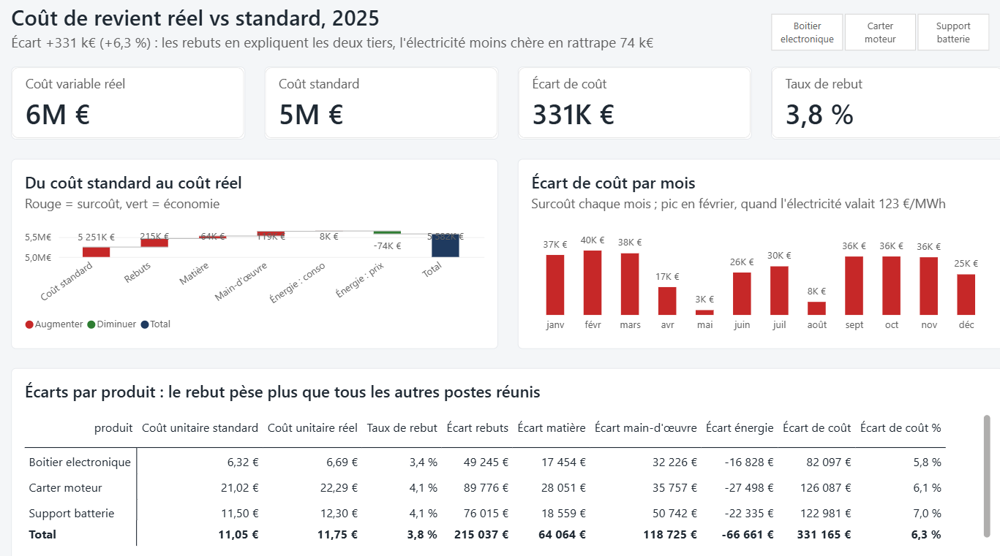
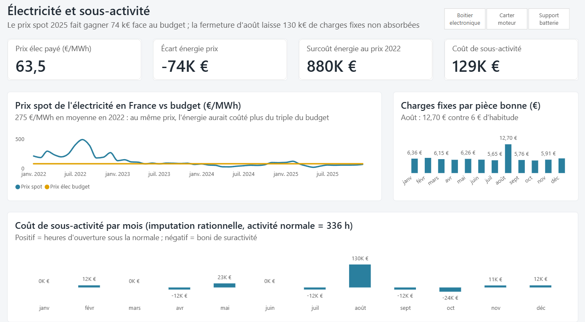

# Usine : coût de revient réel vs standard

**Question de gestion** : une usine de pièces automobiles (3 produits, 2 équipes) a-t-elle tenu ses coûts standards en 2025 ? Si non, où part l'argent : matière, main-d'œuvre, énergie, rebuts ? Et combien coûtent la fermeture d'août et la volatilité du prix de l'électricité ?

Prix de l'électricité : **réels** (prix spot mensuel France 2022-2025, Ember / ENTSO-E).
Production, consommations et charges : simulées avec une graine fixe, donc reproductibles.



---

## Résultats

| | 2025 |
|---|---:|
| Coût variable standard (pour 475 048 pièces bonnes) | 5 250 606 € |
| Coût variable réel | 5 581 771 € |
| **Écart** | **+331 165 € (+6,3 %)** |
| dont rebuts (3,8 % des pièces fabriquées) | +215 037 € |
| dont main-d'œuvre (rendement +74 k€, taux horaire +45 k€) | +118 725 € |
| dont matière (quantité +48 k€, prix +16 k€) | +64 064 € |
| dont énergie, consommation | +7 564 € |
| dont énergie, prix de l'électricité | −74 225 € |

| Produit | Coût unitaire standard | Coût unitaire réel | Taux de rebut | Écart total |
|---|---:|---:|---:|---:|
| Carter moteur | 21,02 € | 22,29 € | 4,1 % | +126 k€ |
| Support batterie | 11,50 € | 12,30 € | 4,1 % | +123 k€ |
| Boîtier électronique | 6,32 € | 6,69 € | 3,4 % | +82 k€ |

**Trois constats pour la direction :**

1. **Le rebut est le premier levier.** Il pèse 215 k€, soit plus que la matière, la main-d'œuvre et l'énergie réunies. Ramener le taux de rebut de 3,8 % à 2 % ferait gagner environ 100 k€ par an.
2. **L'électricité a sauvé l'année, par chance.** Le budget retenait 80 €/MWh ; le prix spot 2025 est sorti à 63 €/MWh en moyenne, d'où 74 k€ d'économie. Avec les prix de 2022 (275 €/MWh en moyenne), les 4 509 MWh consommés auraient coûté environ 880 k€ de plus que le budget. Une couverture (contrat à prix fixe) mérite d'être étudiée.
3. **La fermeture d'août coûte 130 k€ de sous-activité.** Les charges fixes (≈ 250 k€ par mois) ne baissent pas quand l'usine ferme : par pièce bonne, elles passent de 6 € à 12,70 € en août.



---

## Méthode

**1. Coût standard** (`requetes/01_cout_standard.sql`)

Pour une pièce : matière (kg × €/kg) + main-d'œuvre (heures × €/h) + énergie (kWh × €/MWh / 1000).

**2. Décomposition de l'écart**

On compare le réel au standard des pièces **fabriquées** (bonnes + rebutées), puis on isole le coût des rebuts :

```
Écart rebuts                 = pièces rebutées × coût standard unitaire
Écart matière quantité       = (kg réels − kg standard) × prix standard
Écart matière prix           = (prix réel − prix standard) × kg réels
Écart main-d'œuvre rendement = (heures réelles − heures standard) × taux standard
Écart main-d'œuvre taux      = (taux réel − taux standard) × heures réelles
Écart énergie consommation   = (kWh réels − kWh standard) × prix standard
Écart énergie prix           = (prix réel − prix standard) × kWh réels

Somme des 7 écarts = coût réel − coût standard des pièces bonnes
```

L'effet **quantité** relève de l'atelier, l'effet **prix** des achats : la décomposition dit à qui poser la question.

**3. Charges fixes et sous-activité (imputation rationnelle)**

Activité normale = 21 jours × 2 équipes de 8 h = 336 heures par mois.
`Coût de sous-activité = charges fixes du mois × (1 − heures d'ouverture / 336)`.
Positif quand l'usine tourne moins que la normale (août : 160 h), négatif (boni) quand elle tourne plus.

**4. Contrôles**

- La somme des écarts redonne l'écart total, au centime, pour chaque produit (mesure `Contrôle écarts`, page masquée « Contrôles » du rapport).
- Les montants Power BI sont identiques aux requêtes SQL (`requetes/`).

## Rapport Power BI

Projet au format **PBIP** (`cout_de_revient.pbip`) : le modèle (TMDL) et le rapport (PBIR) sont des fichiers texte, lisibles et versionnés dans Git.

- **Modèle** : `production` (fait mensuel par produit), `standards` (dimension produit), `charges_fixes`, `prix_spot`, `Mois` et `Pont` (tables calculées DAX).
- **34 mesures DAX**, rangées par dossier : volumes, coûts, écarts, énergie, charges fixes.
- **Pages** : Écarts de coût (cascade du standard au réel, écart par mois, matrice par produit) ; Énergie et activité (prix spot vs budget, charges fixes par pièce, sous-activité).

Exemple de mesure :

```DAX
Écart matière quantité =
SUMX (
    production,
    ( production[kg_reel] - production[quantite_fabriquee] * RELATED ( standards[kg_std] ) )
        * RELATED ( standards[prix_matiere_std] )
)
```

## Reproduire

```bash
python generer_donnees.py          # écrit les 4 CSV dans donnees/
createdb -U postgres usine
psql -U postgres -d usine -f charger_base.sql
psql -U postgres -d usine -f requetes/03_ecart_matiere.sql
```

Puis ouvrir `cout_de_revient.pbip` dans Power BI Desktop. Si le dossier n'est pas `C:\portfolio\02-usine-cout-de-revient`, modifier le paramètre **Dossier** (Transformer les données > Gérer les paramètres) et actualiser.

**Outils** : Python, PostgreSQL, Power BI (DAX, Power Query).
